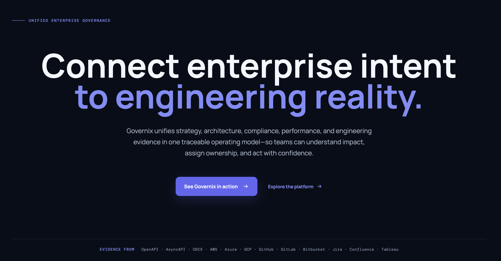

<h1> Governix Public Roadmap</h1>

Welcome to the public home for Governix product updates and community feedback.

Use this repository to follow what we are working on, suggest improvements, report problems, and see what has shipped.

## Explore

- [Roadmap and community issues](https://github.com/governix-studio/public-roadmap/issues)
- [Open a new issue](https://github.com/governix-studio/public-roadmap/issues/new)
- [Releases and release notes](https://github.com/governix-studio/public-roadmap/releases)

## Suggest a feature

[Open an issue](https://github.com/governix-studio/public-roadmap/issues/new) and describe:

- The problem or need you have
- Who it affects and in what situation
- The outcome you would like to achieve
- Any context or examples that could help us understand it

## Report a bug

[Open an issue](https://github.com/governix-studio/public-roadmap/issues/new). Include steps to reproduce the problem, what you expected to happen, what happened instead, and relevant browser or environment details. Please do not include passwords, tokens, personal data, or other sensitive information.

## How the roadmap works

Roadmap items reflect current priorities and may change as we learn from users and adjust our plans. A roadmap entry is an indication of intent, not a delivery commitment. We will share shipped changes in [Releases](https://github.com/governix-studio/public-roadmap/releases).

Before opening a new issue, please search existing issues to see whether someone has already raised the same request or problem. You can add details or reactions to an existing issue.

## About Governix

Governix helps organizations connect governance, architecture, product decisions, and software delivery in one operating landscape.

Learn more at [governix.io](https://governix.io).
